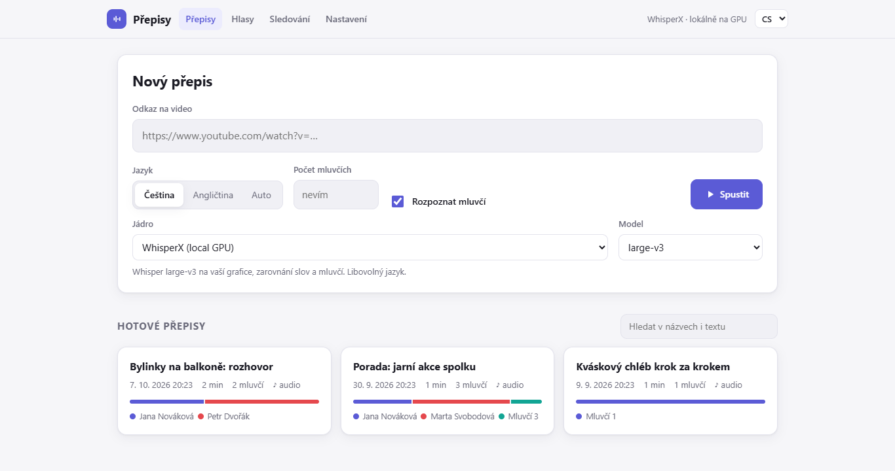
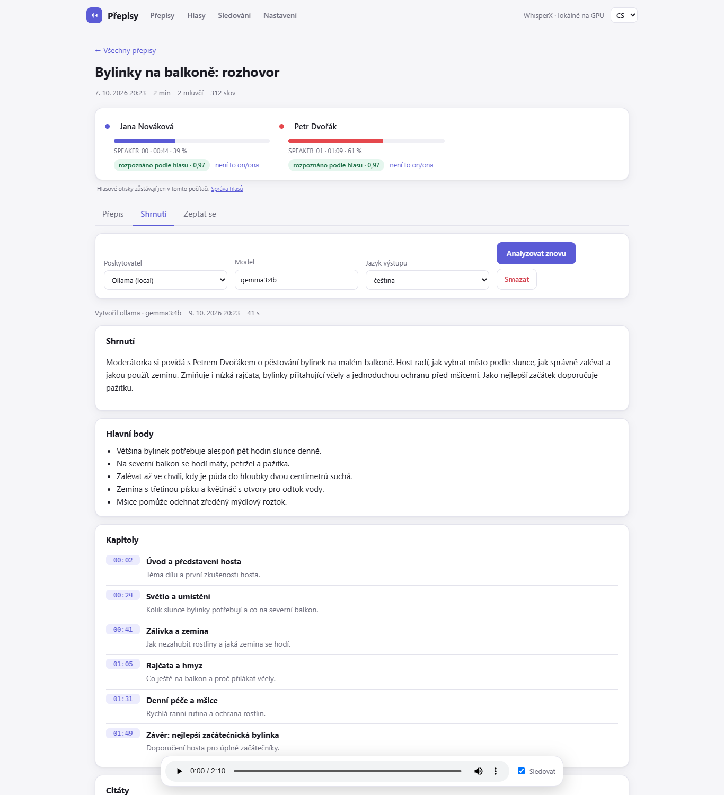

[English](README.md) | **Čeština**

# MGTranscriber

Přepis audia a videa s rozlišením mluvčích na vlastním Windows PC s NVIDIA GPU. Nic se nenahrává, pokud si sami
nezvolíte cloudový engine, takže nahrávky, které musí zůstat v soukromí, zůstanou na vašem počítači.

<picture>
  <source media="(prefers-color-scheme: dark)" srcset="docs/img/library-dark.png">
  
</picture>

<picture>
  <source media="(prefers-color-scheme: dark)" srcset="docs/img/summary-dark.png">
  
</picture>

*Snímky obrazovky používají vymyšlená demo data (`tools/make_demo_data.py`), žádné cizí audio ani text. Více v
[docs/img](docs/img): [hlasová paměť](docs/img/voices-light.png), [sledované zdroje](docs/img/watch-light.png).*

## Funkce

- **Přepis s mluvčími**: [WhisperX](https://github.com/m-bain/whisperX) (Whisper large-v3, zarovnání slov,
  [pyannote](https://github.com/pyannote/pyannote-audio) diarizace), dále NVIDIA Parakeet a Canary. Časy na úrovni slov.
- **Zdroje**: místní audio/video soubory, YouTube a další odkazy ([yt-dlp](https://github.com/yt-dlp/yt-dlp)),
  RSS kanály podcastů a vestavěný **rekordér** (mikrofon v prohlížeči).
- **Webové rozhraní** s frontou úloh, živým logem, fulltextovým hledáním napříč všemi přepisy (nezávislé na
  diakritice) a přehrávačem zvuku, který sleduje text.
- **Editor**: opravujte text a mluvčí, zatímco hraje zvuk; zpět, rozdělení/sloučení, uložené verze
  redakce textu i zvuku ([docs/EDITOR.md](docs/EDITOR.md)).
- **Překrývající se řeč (experimentální)**: *Oddělit hlasy (souběžná řeč)* před přepisem rozdělí nahrávku na jednu stopu na
  mluvčího ([docs/USER_GUIDE.md](docs/USER_GUIDE.md)).
- **Knihovna**: složky, fulltextové hledání, mazání s potvrzením.
- **Hlasová paměť**: jednou pojmenujete mluvčího, další přepisy ho poznají podle hlasu ([docs/VOICES.md](docs/VOICES.md)).
- **Shrnutí, kapitoly, citace, úkoly, otázky a překlad** přepisu pomocí lokálního LLM přes
  [Ollama](https://ollama.com) (volitelně Gemini nebo Claude) ([docs/LLM.md](docs/LLM.md)).
- **Sledování**: nové soubory ve složce, nové díly podcastů a nová videa z YouTube kanálu se automaticky zařadí do
  fronty, po dokončení volitelně i přeloží ([docs/WATCH.md](docs/WATCH.md)).
- **Export**: TXT, SRT, VTT, JSON, Markdown, DOCX.
- **API kompatibilní s OpenAI** (`/v1/audio/transcriptions`) a **MCP server** pro Claude, Cursor a VS Code
  ([docs/API.md](docs/API.md), [docs/MCP.md](docs/MCP.md)).
- **Režim citlivých dat**: offline režim, redakce textu i zvuku, řetězec úschovy, auditní log, bezpečné mazání
  ([docs/PRIVACY.md](docs/PRIVACY.md)).
- **Jakýkoli jazyk, který Whisper podporuje**, rozpoznaný automaticky; 25 evropských jazyků s Parakeet a Canary.
  Webové rozhraní je anglicky a česky a řídí se prohlížečem.

## Instalace

Potřebujete Windows 10/11 a pro rozumnou rychlost NVIDIA GPU (pro large-v3 stačí 8 GB VRAM). Bez GPU všechno
funguje na CPU, mnohem pomaleji. Počítejte s 3–5 GB místa na disku pro aplikaci a několika GB pro modely (celkem asi 10 GB).

**Instalátor (doporučeno).** Stáhněte projekt jako ZIP z GitHubu, rozbalte ho a spusťte **`install.bat`**. Rozpozná
vaši GPU, nainstaluje PyTorch, [uv](https://docs.astral.sh/uv/), ffmpeg a [Deno](https://deno.com), pokud chybí
(při prvním spuštění 3–5 GB), pomůže s nastavením tokenu Hugging Face a vytvoří zástupce. Nevyžaduje práva
administrátora a lze jej bezpečně spustit znovu (`install.bat -Repair`, `install.bat -Uninstall`; vaše přepisy
a `.env` se zachovají).

**Jeden řádek v PowerShellu** (instaluje do `%LOCALAPPDATA%\Programs\mgtranscriber`):

```
irm https://raw.githubusercontent.com/Michal1609/MGTranscriber/main/install.ps1 | iex
```

> Spustit skript z internetu znamená mu věřit. Nejdřív si ho přečtěte:
> `irm https://raw.githubusercontent.com/Michal1609/MGTranscriber/main/install.ps1 | more`, nebo ho stáhněte, zkontrolujte
> a spusťte `install.bat`.

**Docker** (Linux, NAS, Windows s WSL2), varianty GPU a CPU; podrobnosti v [docs/DOCKER.md](docs/DOCKER.md):

```
cp .env.example .env && docker compose up -d     # http://localhost:8000
```

**Ručně** pomocí [uv](https://docs.astral.sh/uv/), ffmpeg v PATH a NVIDIA ovladače s CUDA 12.8:

```
uv sync --no-dev                                  # PyTorch pro CUDA 12.8
uv sync --no-dev --no-group cu128 --group cpu     # nebo: bez NVIDIA GPU (macOS, Linux arm64)
copy .env.example .env                            # pak doplňte HF_TOKEN
```

### Token Hugging Face (pro rozpoznávání mluvčích)

Rozpoznávání mluvčích stahuje modely pyannote, které je nutné jednou odsouhlasit podmínky použití. Vytvořte si
bezplatný účet na Hugging Face, otevřete
[pyannote/speaker-diarization-community-1](https://huggingface.co/pyannote/speaker-diarization-community-1), klikněte
na **Agree** a vytvořte token typu **Read** na <https://huggingface.co/settings/tokens>. Vložte ho na stránku
**Settings** ve webovém rozhraní (nebo do `.env` jako `HF_TOKEN=`). Bez tokenu můžete stále přepisovat pomocí
`--no-diarize`.

## První přepis za dvě minuty

1. Spusťte webové rozhraní: `web.bat` (nebo zkratka z nabídky Start). Otevře se <http://127.0.0.1:8000>.
2. Vložte odkaz do **New transcript**, zvolte jazyk a případně, pokud ho znáte, počet mluvčích.
3. Stiskněte **Start**. Při prvním spuštění se stahují modely, takže to trvá několik minut navíc.
4. Až je úloha hotová, otevřete přepis ze seznamu.

Z příkazové řádky funguje i místní soubor:

```
uv run mgtranscriber transcribe interview.mp4 --language en --speakers 2
uv run mgtranscriber transcribe "https://www.youtube.com/watch?v=..." --no-diarize
```

Výsledky se uloží do `output/<název>/`: `prepis.txt`, `titulky.srt`, `prepis.json` (slova s časy a mluvčími),
`metadata.json` a zvuk. Postup krok za krokem: [docs/USER_GUIDE.md](docs/USER_GUIDE.md).

## Dokumentace

| | |
|---|---|
| [Uživatelská příručka](docs/USER_GUIDE.md) | od instalace po export, časté problémy |
| [Editor](docs/EDITOR.md) | klávesy, časy slov, verze |
| [Hlasová paměť](docs/VOICES.md) | rozpoznávání lidí napříč nahrávkami |
| [Shrnutí a otázky](docs/LLM.md) | Ollama, Gemini, Claude |
| [Sledování zdrojů](docs/WATCH.md) | složky, RSS, YouTube kanály |
| [Soukromí a citlivá data](docs/PRIVACY.md) | offline režim, redakce, úschova |
| [API](docs/API.md) / [MCP](docs/MCP.md) | API kompatibilní s OpenAI, MCP pro AI asistenty |
| [Docker](docs/DOCKER.md) | GPU/CPU, Unraid, TrueNAS |
| [Architektura](docs/ARCHITECTURE.md) | struktura, přidání enginu nebo exportéru |
| [Benchmark](docs/benchmark-en.md) / [Český benchmark](docs/benchmark-cs.md) | přesnost a rychlost enginů |

## Engine

Vyberte pomocí `--engine` / `-e` nebo ve webovém rozhraní. Lokální enginy neodesílají nic mimo váš počítač. Cloudové
enginy jsou vypnuté, dokud nepřidáte API klíč, a rozhraní varuje, že audio opouští váš počítač.

| engine | běží na | vhodný pro |
|---|---|---|
| `whisperx` (výchozí) | lokální GPU | libovolný jazyk; Whisper large-v3, nebo `-m large-v3-turbo` pro rychlost |
| `parakeet` | lokální GPU | nejrychlejší samotné rozpoznání, 25 evropských jazyků; jazyk rozpozná sám. S rozpoznáním mluvčích trvá celý přepis zhruba stejně jako s `large-v3-turbo` (viz níže) |
| `canary` | lokální GPU | 25 evropských jazyků, v našem testu nejpřesnější pro češtinu; jazyk se musí zadat |
| `youtube` | bez GPU | existující titulky YouTube za pár sekund; bez titulků přejde na `whisperx` |
| `elevenlabs`, `deepgram`, `gemini` | **cloud** | volitelné; potřebují API klíč v `.env` |

Angličtina ([docs/benchmark-en.md](docs/benchmark-en.md); WER %, přes aplikaci, RTX 5070 Laptop, jen lokální enginy):

| model | LibriSpeech clean | LibriSpeech other | FLEURS en | AMI porady, WER / DER | AMI (86 min), celý přepis s mluvčími |
|---|---|---|---|---|---|
| Whisper large-v3 | 2,0 | 3,8 | 6,4 | 25,6 / 31,5 | 7,3 min |
| Whisper large-v3-turbo | 1,9 | 4,1 | 7,3 | 25,7 / 30,8 | 5,3 min |
| Parakeet-TDT-0.6B-v3 | 3,1 | 4,1 | 6,6 | **22,4 / 25,0** | **4,8 min** |
| Canary-1B-v2 | 2,3 | 4,1 | 6,3 | 26,2 / 30,7 | 7,1 min |

Čeština ([docs/benchmark-cs.md](docs/benchmark-cs.md)) měřila 300 českých promluv z FLEURS (čtená řeč, 60 minut, stejný notebook):

| model (běh) | WER | rychlost |
|---|---|---|
| Canary-1B-v2 (model / aplikace) | 9,0 % / 9,6 % | 11× / 12× reálný čas |
| Whisper large-v3 (model) | 10,5 % | 8× reálný čas |
| Parakeet-TDT-0.6B-v3 (aplikace) | 10,5 % | 45× reálný čas |
| Whisper large-v3-turbo (model) | 10,9 % | 29× reálný čas |
| Parakeet-TDT-0.6B-v3 (model) | 11,4 % | 46× reálný čas |

Celé přepisy včetně rozpoznání mluvčích (88minutový anglický rozhovor, 2 mluvčí, stejný notebook):
`large-v3-turbo` 5 min 55 s, `parakeet` 6 min 27 s, `canary` 7 min 48 s. Rozpoznání mluvčích (u této nahrávky
asi 3 minuty) trvá u všech jader stejně dlouho, takže rychlejší rozpoznání u Parakeetu se v celkovém čase skoro
neprojeví.

Na čisté čtené řeči jsou jádra blízko sebe (v angličtině o zhruba bod WER; v češtině byl nejpřesnější Canary,
9,0 % proti 10,5 % u large-v3). Na skutečné anglické poradě byl nejpřesnější a nejrychlejší Parakeet, o 3 body WER
lepší než ostatní; přiřazení mluvčích bylo u všech přesné (zhruba 2 % záměn) a DER tvoří hlavně nepřepsaná řeč.
Na české parlamentní řeči s mluvčími (88 minut) vyšlo WER 8,1–10,1 % a DER 2,8–4,7 %. Na domácích nahrávkách Common Voice cs (300 klipů) vyšlo WER 9,9–11,7 % a rozdíly mezi jádry nejsou prokazatelné. Čtená řeč je jednodušší než
skutečné rozhovory a pořadí modelů se mezi datovými sadami nezachovává. Podrobnosti, postup a omezení:
[docs/benchmark-en.md](docs/benchmark-en.md), [docs/benchmark-cs.md](docs/benchmark-cs.md).

## Soukromí

Lokální enginy, lokální LLM, hlasová paměť a hledání běží na vašem počítači a webový server naslouchá ve výchozím
nastavení jen na `127.0.0.1`. Co může opustit váš počítač, a to jen když o to požádáte: audio odeslané do cloudového
enginu, text přepisu odeslaný do cloudového LLM a stahování modelů a médií z odkazů. **Offline režim** blokuje první
dvě věci a také odkazy. Stahování modelů je jediná věc, kterou nezastaví (neodesílá se při něm žádné audio ani text);
pro počítač bez připojení k síti stáhněte modely jednou a nastavte `HF_HUB_OFFLINE=1`. Chcete-li server zpřístupnit
v síti, nastavte `MGTRANSCRIBER_API_KEY`. Viz [docs/PRIVACY.md](docs/PRIVACY.md), včetně toho, co tyto funkce
**nezaručují**.

## YouTube a podmínky služby

Toto je nástroj pro přepis obsahu, ke kterému máte právo: vlastní nahrávky, obsah s otevřenou licencí nebo použití
povolené zákonem (například citace, výzkum, zpravodajství). Odpovídáte za to, co stáhnete a jak to použijete, včetně
souladu s podmínkami služby YouTube a autorským právem. Autoři neschvalují porušování autorských práv ani podmínek
služby. Stahování z YouTube potřebuje pro yt-dlp JavaScriptové běhové prostředí ([Deno](https://deno.com) 2.3+
nebo Node.js 22+); instalátor ho nastaví.

## Licence a třetí strany

Kód je pod [licencí Apache 2.0](LICENSE). Modely a knihovny mají vlastní licence (pyannote community-1, Parakeet
a Canary jsou CC-BY-4.0; model pyannote také vyžaduje odsouhlasení podmínek na Hugging Face). Přehled a povinná
uvedení autorství: [THIRD_PARTY_NOTICES.md](THIRD_PARTY_NOTICES.md).

## Přispívání

Hlášení chyb, opravy dokumentace a pull requesty jsou vítány: [CONTRIBUTING.md](CONTRIBUTING.md). Testy běží
bez GPU (`uv run pytest`). Bezpečnostní problémy: [SECURITY.md](SECURITY.md).
