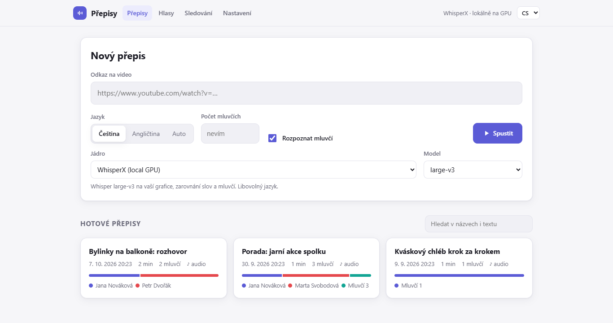
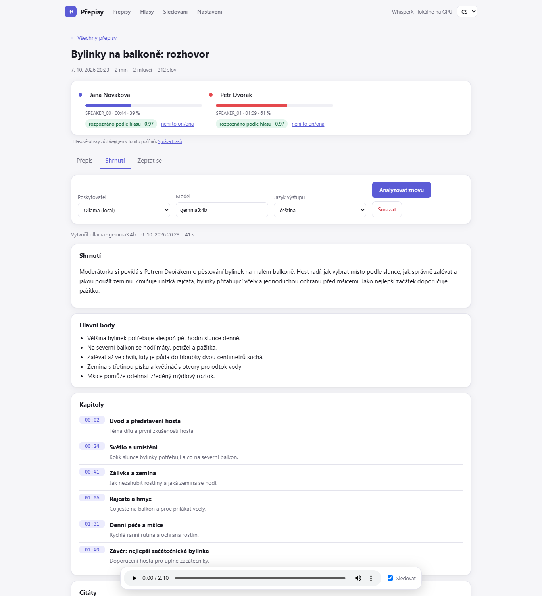

**English** | [Čeština](README.cs.md)

# MGTranscriber

Transcribe audio and video, with speakers told apart, on your own Windows PC with an NVIDIA GPU. Nothing is uploaded
unless you choose a cloud engine, so recordings that must stay private stay on your machine.

<picture>
  <source media="(prefers-color-scheme: dark)" srcset="docs/img/library-dark.png">
  
</picture>

<picture>
  <source media="(prefers-color-scheme: dark)" srcset="docs/img/summary-dark.png">
  
</picture>

*Screenshots use made-up demo data (`tools/make_demo_data.py`), no third-party audio or text. More in
[docs/img](docs/img): [voice memory](docs/img/voices-light.png), [watched sources](docs/img/watch-light.png).*

## Features

- **Transcription with speakers**: [WhisperX](https://github.com/m-bain/whisperX) (Whisper large-v3, word alignment,
  [pyannote](https://github.com/pyannote/pyannote-audio) diarization), plus NVIDIA Parakeet and Canary. Word-level times.
- **Sources**: local audio/video files, YouTube and other links ([yt-dlp](https://github.com/yt-dlp/yt-dlp)),
  podcast RSS feeds, and a built-in **recorder** (microphone, in the browser).
- **Web UI** with a job queue, live log, full-text search across all transcripts (diacritics-insensitive) and an audio player
  that follows the text.
- **Editor**: correct text and speakers while the audio plays, undo, split/merge, stored versions,
  redaction of text and audio ([docs/EDITOR.md](docs/EDITOR.md)).
- **Overlapping speech (experimental)**: *Separate voices* splits the recording into one track per speaker before
  transcribing ([docs/USER_GUIDE.md](docs/USER_GUIDE.md)).
- **Library**: folders, full-text search, delete with confirmation.
- **Voice memory**: name a speaker once, later transcripts recognise them by voice ([docs/VOICES.md](docs/VOICES.md)).
- **Summary, chapters, quotes, action items, questions and translation** of a transcript, by a local LLM through
  [Ollama](https://ollama.com) (optionally Gemini or Claude) ([docs/LLM.md](docs/LLM.md)).
- **Watching**: new files in a folder, new podcast episodes, new videos of a YouTube channel are queued automatically,
  optionally translated when finished ([docs/WATCH.md](docs/WATCH.md)).
- **Exports**: TXT, SRT, VTT, JSON, Markdown, DOCX.
- **OpenAI-compatible API** (`/v1/audio/transcriptions`) and an **MCP server** for Claude, Cursor and VS Code
  ([docs/API.md](docs/API.md), [docs/MCP.md](docs/MCP.md)).
- **Sensitive-data mode**: offline mode, redaction in text and audio, chain of custody, audit log, secure deletion
  ([docs/PRIVACY.md](docs/PRIVACY.md)).
- **Any language Whisper supports**, detected automatically; 25 European languages with Parakeet and Canary.
  The web UI is in English and Czech and follows your browser.

## Install

You need Windows 10/11 and, for reasonable speed, an NVIDIA GPU (8 GB VRAM is enough for large-v3). Without a GPU
everything works on the CPU, much slower. Plan for about 3-5 GB of disk for the app plus several GB for models (about 10 GB in total).

**Installer (recommended).** Download the project as a ZIP from [GitHub](https://github.com/Michal1609/MGTranscriber), unpack it and run **`install.bat`**. It
detects your GPU, installs PyTorch, [uv](https://docs.astral.sh/uv/), ffmpeg and [Deno](https://deno.com)
where missing (3-5 GB the first time), helps you set up the Hugging Face token, and creates shortcuts. It needs no
administrator rights and can be re-run safely (`install.bat -Repair`, `install.bat -Uninstall`; your
transcripts and `.env` are kept).

**One line in PowerShell** (installs to `%LOCALAPPDATA%\Programs\mgtranscriber`):

```
irm https://raw.githubusercontent.com/Michal1609/MGTranscriber/main/install.ps1 | iex
```

> Running a script from the internet means trusting it. Read it first:
> `irm https://raw.githubusercontent.com/Michal1609/MGTranscriber/main/install.ps1 | more`, or download it, check it and run
> `install.bat`.

**Docker** (Linux, NAS, Windows with WSL2), GPU and CPU variants; details in [docs/DOCKER.md](docs/DOCKER.md):

```
cp .env.example .env && docker compose up -d     # http://localhost:8000
```

**Manually** with [uv](https://docs.astral.sh/uv/), ffmpeg on PATH and an NVIDIA driver with CUDA 12.8:

```
uv sync --no-dev                                  # PyTorch for CUDA 12.8
uv sync --no-dev --no-group cu128 --group cpu     # or: no NVIDIA GPU (macOS, Linux arm64)
copy .env.example .env                            # then fill in HF_TOKEN
```

### Hugging Face token (for speaker recognition)

Speaker recognition downloads pyannote models, which require accepting their terms once. Create a free
Hugging Face account, open
[pyannote/speaker-diarization-community-1](https://huggingface.co/pyannote/speaker-diarization-community-1), click
**Agree**, and create a token of type **Read** at <https://huggingface.co/settings/tokens>. Paste it on the web
UI's **Settings** page (or into `.env` as `HF_TOKEN=`). Without a token you can still transcribe with
`--no-diarize`.

## First transcript in two minutes

1. Start the web UI: `web.bat` (or the Start menu shortcut). It opens <http://127.0.0.1:8000>.
2. Paste a link into **New transcript**, choose the language and, if you know it, the number of speakers.
3. Press **Start**. The first run downloads models, so it takes a few minutes longer.
4. When the job is done, open the transcript from the list.

From the command line, a local file works as well:

```
uv run mgtranscriber transcribe interview.mp4 --language en --speakers 2
uv run mgtranscriber transcribe "https://www.youtube.com/watch?v=..." --no-diarize
```

Results go to `output/<title>/`: `prepis.txt`, `titulky.srt`, `prepis.json` (words with times and speakers),
`metadata.json` and the audio. Step-by-step: [docs/USER_GUIDE.md](docs/USER_GUIDE.md).

## Documentation

| | |
|---|---|
| [User guide](docs/USER_GUIDE.md) | install to export, common problems |
| [Editor](docs/EDITOR.md) | keys, word times, versions |
| [Voice memory](docs/VOICES.md) | recognising people across recordings |
| [Summaries and questions](docs/LLM.md) | Ollama, Gemini, Claude |
| [Watching sources](docs/WATCH.md) | folders, RSS, YouTube channels |
| [Privacy and sensitive data](docs/PRIVACY.md) | offline mode, redaction, custody |
| [API](docs/API.md) / [MCP](docs/MCP.md) / [Integrations](docs/INTEGRATIONS.md) | OpenAI-compatible API, MCP for AI assistants, Open WebUI / n8n / Home Assistant |
| [Docker](docs/DOCKER.md) | GPU/CPU, Unraid, TrueNAS |
| [Architecture](docs/ARCHITECTURE.md) | structure, adding an engine or exporter |
| [Benchmark](docs/benchmark-en.md) / [Czech benchmark](docs/benchmark-cs.md) | accuracy and speed of the engines |

## Engines

Choose with `--engine` / `-e` or in the web UI. Local engines send nothing off your machine. Cloud engines are
off until you add an API key, and the UI warns that the audio leaves your computer.

| engine | runs | good for |
|---|---|---|
| `whisperx` (default) | local GPU | any language; Whisper large-v3, or `-m large-v3-turbo` for speed |
| `parakeet` | local GPU | fastest recognition step, 25 European languages; detects the language itself. With speaker detection the whole transcript takes about as long as `large-v3-turbo` (see below) |
| `canary` | local GPU | 25 European languages, most accurate for Czech in our test; language must be given |
| `youtube` | no GPU | existing YouTube captions in seconds; falls back to `whisperx` without captions |
| `elevenlabs`, `deepgram`, `gemini` | **cloud** | optional; need an API key in `.env` |

English ([docs/benchmark-en.md](docs/benchmark-en.md); WER %, through the application, RTX 5070 Laptop, local engines only):

| model | LibriSpeech clean | LibriSpeech other | FLEURS en | AMI meetings, WER / DER | AMI set (86 min), whole transcript with speakers |
|---|---|---|---|---|---|
| Whisper large-v3 | 2.0 | 3.8 | 6.4 | 25.6 / 31.5 | 7.3 min |
| Whisper large-v3-turbo | 1.9 | 4.1 | 7.3 | 25.7 / 30.8 | 5.3 min |
| Parakeet-TDT-0.6B-v3 | 3.1 | 4.1 | 6.6 | **22.4 / 25.0** | **4.8 min** |
| Canary-1B-v2 | 2.3 | 4.1 | 6.3 | 26.2 / 30.7 | 7.1 min |

Czech ([docs/benchmark-cs.md](docs/benchmark-cs.md)) measured 300 Czech FLEURS utterances (read speech, 60 minutes, same laptop):

| model (run) | WER | speed |
|---|---|---|
| Canary-1B-v2 (model / app) | 9.0 % / 9.6 % | 11x / 12x realtime |
| Whisper large-v3 (model) | 10.5 % | 8x realtime |
| Parakeet-TDT-0.6B-v3 (app) | 10.5 % | 45x realtime |
| Whisper large-v3-turbo (model) | 10.9 % | 29x realtime |
| Parakeet-TDT-0.6B-v3 (model) | 11.4 % | 46x realtime |

Whole transcripts, including speaker detection (an 88-minute English interview, 2 speakers, same laptop):
`large-v3-turbo` 5 min 55 s, `parakeet` 6 min 27 s, `canary` 7 min 48 s. Speaker detection (about 3 minutes
for this recording) takes the same time with every engine, so the faster recognition step of Parakeet barely
shows in the total.

On clean read speech the engines are close (about one point of WER in English; in Czech Canary was the most
accurate, 9.0 % against 10.5 % for large-v3). On a real English meeting Parakeet was the most accurate and the
fastest, 3 points of WER better than the others; speaker attribution was accurate for all (about 2 % confusion), and the
DER is mostly speech that was not transcribed. On Czech parliamentary speech with speakers (88 minutes) the WER was
8.1-10.1 % and the DER 2.8-4.7 %. Read speech is easier than real conversations and the order of the models is not
stable between data sets. Details, method and limits: [docs/benchmark-en.md](docs/benchmark-en.md),
[docs/benchmark-cs.md](docs/benchmark-cs.md).

## Privacy

Local engines, the local LLM, voice memory and search run on your computer and the web server listens only on
`127.0.0.1` by default. What can leave your machine, and only when you ask for it: audio sent to a cloud engine,
transcript text sent to a cloud LLM, and downloads of model files and of media from links. **Offline mode** blocks
the first two and links as well. Model downloads are the only thing it does not stop (no audio or text is sent
there); for an air-gapped machine download the models once and set `HF_HUB_OFFLINE=1`. To expose the server on a
network, set `MGTRANSCRIBER_API_KEY`. See [docs/PRIVACY.md](docs/PRIVACY.md), including what these features
do **not** guarantee.

## YouTube and Terms of Service

This is a tool for transcribing content you have the right to use: your own recordings, openly licensed content, or
uses permitted by law (for example quotation, research, news reporting). You are responsible for what you download
and how you use it, including compliance with YouTube's Terms of Service and copyright law. The authors do not
condone infringing copyright or terms of service. Downloading from YouTube needs a JavaScript runtime for yt-dlp
([Deno](https://deno.com) 2.3+ or Node.js 22+); the installer sets that up.

## License and third parties

The code is under the [Apache License 2.0](LICENSE). Models and libraries carry their own licenses (pyannote
community-1, Parakeet and Canary are CC-BY-4.0; the pyannote model also requires accepting its terms on Hugging
Face). Overview and required attributions: [THIRD_PARTY_NOTICES.md](THIRD_PARTY_NOTICES.md).

## Contributing

Bug reports, documentation fixes and pull requests are welcome: [CONTRIBUTING.md](CONTRIBUTING.md). Tests run
without a GPU (`uv run pytest`). Security issues: [SECURITY.md](SECURITY.md).
